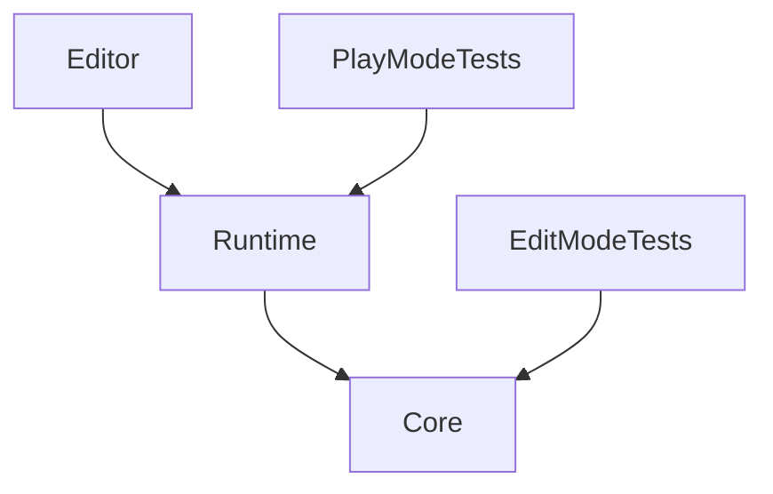
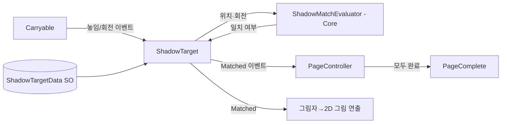

# 아키텍처

> M1 시작 시점의 초안. 시스템이 생기거나 바뀔 때마다 갱신한다.

## 모듈 / asmdef
| asmdef | 책임 | 의존 |
|---|---|---|
| Ritae.Shadowtale.Core | 순수 로직: 그림자 판정(`ShadowMatchEvaluator`), 페이지 진행 상태(`PageProgress`), 공용 타입 | UnityEngine 수학 타입만 (`Vector3`, `Quaternion`) |
| Ritae.Shadowtale.Runtime | MonoBehaviour, 씬 로직, ScriptableObject 정의 | Core, Unity.InputSystem, Unity.Cinemachine, URP |
| Ritae.Shadowtale.Editor | 에디터 도구 (씬 셋업 MenuItem, 그림자 목표 캡처 도구) | Runtime, Core |
| Ritae.Shadowtale.Tests.EditMode | 단위 테스트 | Core |
| Ritae.Shadowtale.Tests.PlayMode | 통합 테스트 (판정→이벤트 흐름) | Runtime, Core |

> Core가 UnityEngine의 수학 타입은 써도 되는 이유: 그림자 판정은 결국 `Vector3`/`Quaternion` 연산이라, 이를 감싸는 자체 타입을 만들면 과설계다. 대신 MonoBehaviour·씬 API는 쓰지 않는다.

## 의존 방향

## Runtime 모듈 (폴더 = 네임스페이스)
| 모듈 | 책임 |
|---|---|
| `Book` | 게임 흐름 상태 머신: Prologue → PageIntro → Puzzle3D → PageComplete → Play2D → PageTurn → … → Epilogue |
| `Player` | 3인칭 캐릭터 이동(CharacterController + Input System) |
| `Carry` | 오브젝트 들기/놓기/회전. `Carryable` 컴포넌트, `CarryController` |
| `Shadow` | 광원(`ShadowLight`), 그림자 벽(`ShadowWall`), 목표(`ShadowTarget`), 판정 연결, 그림자→그림 전환 연출 |
| `Page2D` | 페이지 그림 속 횡스크롤 플레이 (M2) |
| `CameraRig` | Cinemachine 카메라 전환(3인칭 ↔ 벽 클로즈업 ↔ 2D) |
| `UI` | HUD, 메뉴 |

## 핵심 시스템
| 시스템 | 담당 클래스 | 언리얼 대응 | ADR |
|---|---|---|---|
| 게임 흐름 | `BookDirector` (씬 오브젝트) + `BookState` enum | GameMode + GameState | (M3에서) |
| 페이지 진행 | `PageController` (Runtime) / `PageProgress` (Core) | Level Blueprint의 진행 로직 | — |
| 그림자 판정 | `ShadowTarget` (Runtime) → `ShadowMatchEvaluator` (Core) | 없음 (직접 구현) | [[ADR-0001-shadow-match-method]] |
| 운반 | `CarryController`, `Carryable` | Physics Handle Component | — |
| 입력 | Input Actions 에셋 + `PlayerInput` | Enhanced Input (IMC + IA) | — |
| 카메라 | Cinemachine 3 `CinemachineCamera` 우선순위 전환 | Spring Arm + Camera / SetViewTargetWithBlend | — |
| 카툰 렌더링 | URP + Shader Graph (예정) | 포스트 프로세스 머티리얼 / 커스텀 셰이딩 모델 | [[ADR-0002-toon-rendering]] |

## 그림자 퍼즐 데이터 흐름 (M1)

## 씬 구성 / 부트스트랩
- M1: `Scenes/Sandbox/` 아래 Task별 테스트 씬 + `Scenes/Pages/Page_Test01.unity`.
- M3에서 결정: 부트스트랩 씬 + 페이지 씬 Additive 로드 구조 (ADR 예정).

## 데이터 (ScriptableObject)
| SO | 내용 |
|---|---|
| `ShadowTargetData` | 목표 오브젝트 ID, 목표 위치(광원 기준 로컬), 목표 회전, 위치/각도 허용 오차, 대칭 축(회전 대칭 허용) |
| `PageData` | 페이지 ID, 포함된 ShadowTarget 목록, 2D 플레이 씬 참조(M2) |

## 규칙
- 판정 로직은 Core에서 EditMode 테스트로 검증한다. 렌더링된 그림자 픽셀로 판정하지 않는다(ADR-0001).
- 페이지 콘텐츠(목표 위치 등)는 코드에 하드코딩하지 않고 SO로 둔다.
